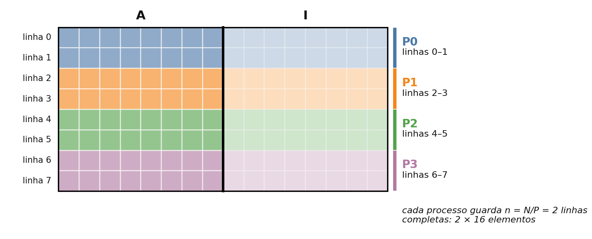
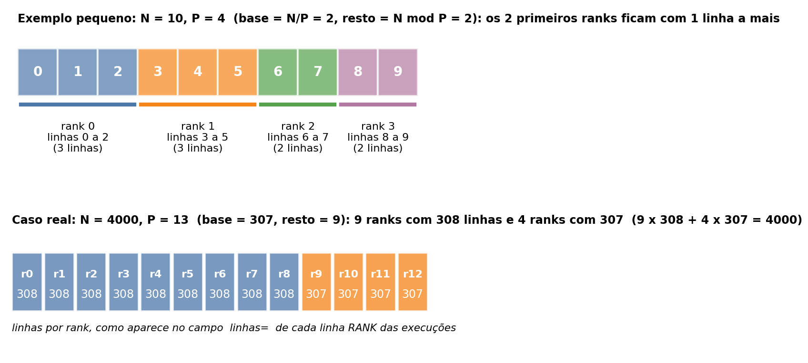
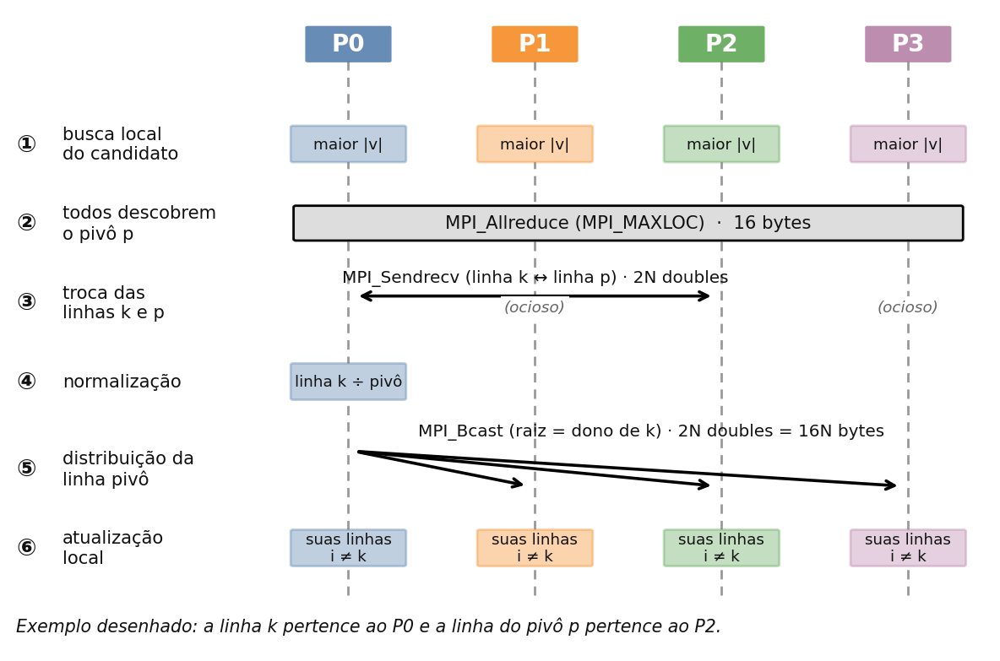
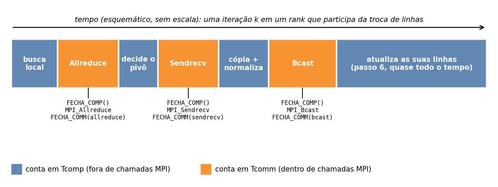
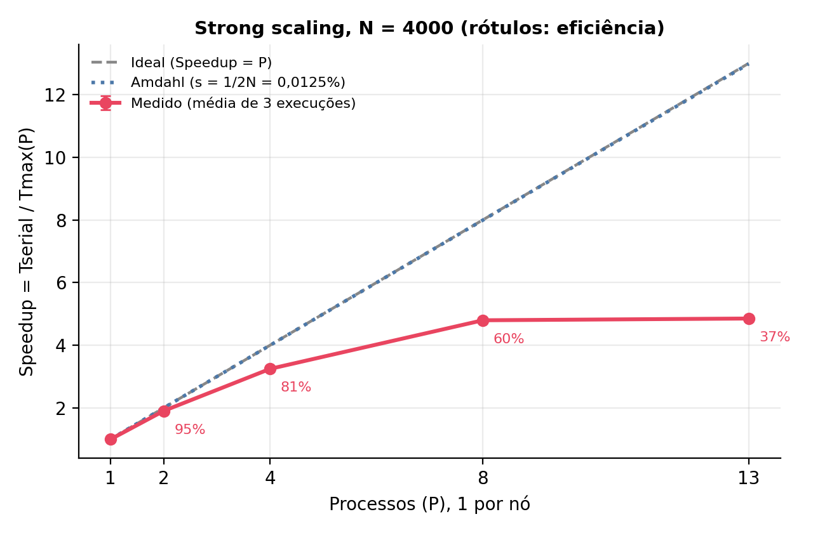
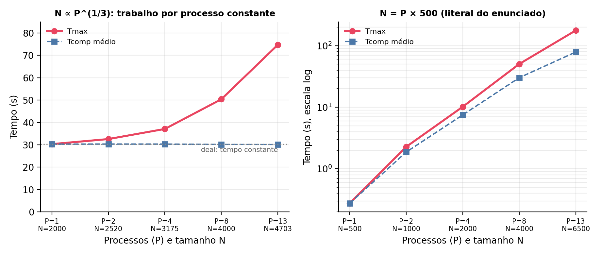
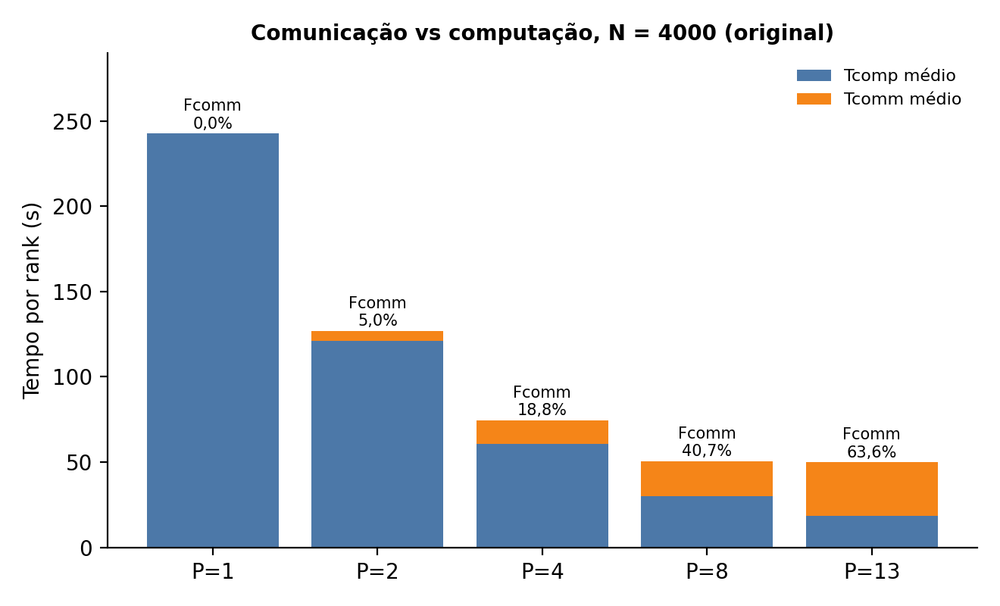
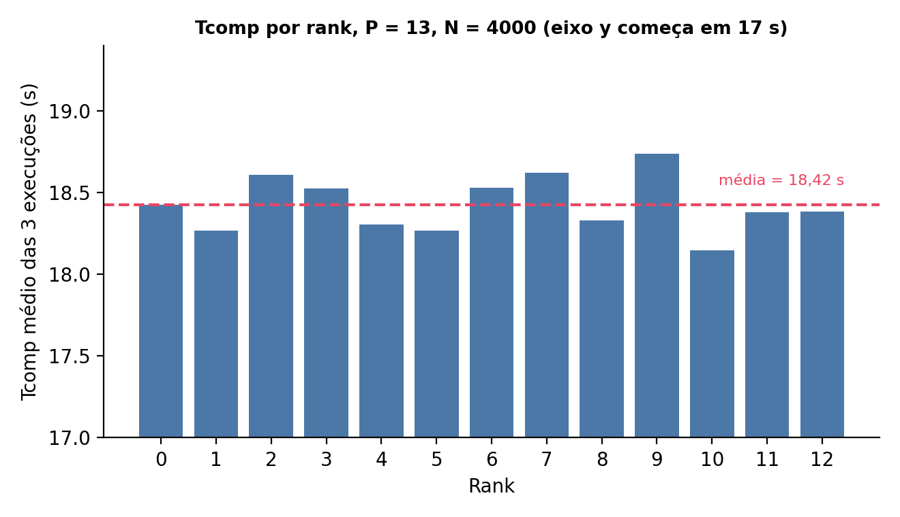
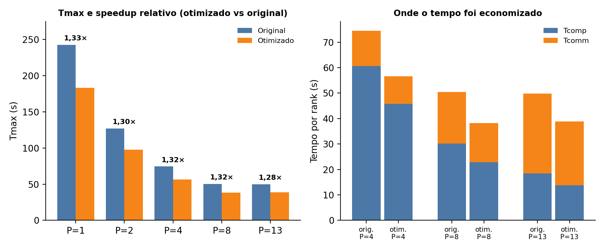

# Inversão de Matriz por Eliminação de Gauss-Jordan com Memória Distribuída (MPI)

**TEC508 - Computação de Alto Desempenho** · UEFS · Prof. Angelo Duarte  
**Integrante:** Joanderson Santos  
**Algoritmo sorteado:** Inversão de Matriz por Eliminação de Gauss-Jordan com pivotamento parcial

Este trabalho paraleliza, com MPI, o mesmo algoritmo do trabalho anterior (memória compartilhada com OpenMP). A matriz aumentada [A | I] é dividida em blocos de linhas entre processos que não compartilham memória, e a comunicação se resume a escolher o pivô, trocar linhas e distribuir a linha pivô. Os experimentos rodam em um cluster de 13 nós (Intel i3-3240, 2 GiB de RAM por nó, Gigabit Ethernet) com N = 4000, o que dá um tempo serial de 241,6 s. O trabalho mede strong e weak scaling, separa o tempo de computação do de comunicação em cada processo, analisa o balanceamento, compara com o OpenMP e propõe e mede uma otimização guiada pelos dados.

## Resultados principais

- **Corretude:** a inversa calculada com MPI é idêntica, elemento a elemento, à do programa serial, para qualquer número de processos testado.
- **Strong scaling (N = 4000):** o speedup chega a **4,85** com 13 processos (eficiência de 37,3%) e já satura em 8 processos (4,80). Com 8 e 13 processos o tempo praticamente não muda (50,4 s e 49,8 s).
- **Causa da saturação:** custo de comunicação crescente, não fração serial (Amdahl com s = 1/2N preveria 13,0 com 13 processos) nem desbalanceamento (Tcomp_max / Tcomp_média de no máximo 1,021). A fração de comunicação sobe de 5,0% (2 processos) para 63,6% (13 processos), e o tempo do `Bcast` da linha pivô acompanha (P − 1) × 0,512 ms, o tempo de enviar 64 KB a 1 Gb/s.
- **Weak scaling:** com o trabalho por processo constante (N ∝ P^(1/3)), o Tcomp fica em ~30 s em todos os P, mas o Tmax sobe de 30,3 s para 74,7 s (eficiência fraca de 40,6% com 13 processos). Com N = P × 500 (literal do enunciado), o tempo vai de 0,28 s a 176,5 s.
- **Otimização:** enviar só as colunas úteis da linha pivô (as à esquerda de k são zeros) reduz 25,0% dos bytes do `Bcast` e dá speedup de **1,28× a 1,33×** sobre a versão original em todos os P, sem mudar o resultado. A saturação, porém, continua.
- **OpenMP vs MPI:** com 4 threads o OpenMP (trabalho anterior) chegou a 1,22× por saturar a banda de memória compartilhada; com 4 processos, um por nó, o MPI chegou a 3,24×. O gargalo trocou de lugar: da memória para a rede.
- **Limitações declaradas:** `/usr/bin/time -v`, mpiP e `perf` não estão instalados no cluster e não foram usados. A seção 12 lista todas.

## Sumário

- [1. Algoritmo, volume de dados e decomposição](#1-algoritmo-volume-de-dados-e-decomposição)
- [2. Código-fonte e ambiente de teste](#2-código-fonte-e-ambiente-de-teste)
- [3. Medições de tempo](#3-medições-de-tempo)
- [4. Strong scaling](#4-strong-scaling)
- [5. Weak scaling](#5-weak-scaling)
- [6. Comunicação vs computação](#6-comunicação-vs-computação)
- [7. mpiP: análise das chamadas MPI mais caras](#7-mpip-análise-das-chamadas-mpi-mais-caras)
- [8. Balanceamento de carga](#8-balanceamento-de-carga)
- [9. OpenMP vs MPI](#9-openmp-vs-mpi)
- [10. Otimização proposta](#10-otimização-proposta)
- [11. Conclusões](#11-conclusões)
- [12. Reprodutibilidade, limitações e dados](#12-reprodutibilidade-limitações-e-dados)

## 1. Algoritmo, volume de dados e decomposição

### 1.1 O algoritmo

A inversa de uma matriz A (N × N, `double`) é obtida transformando a matriz aumentada [A | I] em [I | A⁻¹] com N etapas de eliminação de Gauss-Jordan com pivotamento parcial:

```
para k = 0 ... N-1:
    p = linha i >= k com o maior |M[i][k]|           (pivotamento parcial)
    trocar as linhas k e p
    M[k][:] = M[k][:] / M[k][k]                      (normalização)
    para cada linha i != k:
        M[i][:] = M[i][:] - M[i][k] * M[k][:]        (eliminação)
```

O laço em k é sequencial, mas dentro de uma iteração as linhas são **independentes**: a linha i lê apenas o seu próprio fator M[i][k] e a linha pivô, e escreve só em si mesma. A eliminação concentra mais de 99% do tempo (99,70% medido com o Callgrind no trabalho anterior) e executa O(N³) operações do tipo `M[i][j] -= fator * M[k][j]`. Cada uma lê dois `double` e escreve um para fazer duas operações de ponto flutuante, ou seja, tem baixa intensidade aritmética: é um algoritmo limitado por memória, como o trabalho anterior mostrou.

### 1.2 Volume de dados

A matriz de entrada é gerada por [`gerador_matriz.c`](gerador_matriz.c): valores pseudo-aleatórios em [−1, 1) (splitmix64), determinísticos por (i, j, semente) e **não** diagonalmente dominantes. Isso é essencial: com uma matriz diagonalmente dominante o pivô seria sempre a diagonal e nunca haveria troca de linhas, e o `MPI_Sendrecv` nunca seria exercitado. Com esta matriz, 3991 das 4000 iterações trocam linhas.

O volume foi calibrado no `node1` do cluster com o programa serial (`gcc -O2`), que mostrou crescimento cúbico:

| N | Eliminação (s) | Total do programa (s) |
|---|---|---|
| 300 | 0,037 | 0,089 |
| 1000 | 3,728 | 3,808 |
| 2000 | 30,584 | 30,888 |
| 3000 | 102,292 | 102,970 |
| 4000 | 241,644 | 243,559 |

Com **N = 4000** o serial leva **241,644 s** na eliminação e 243,559 s no total do programa, acima dos 200 s exigidos. O arquivo de entrada tem 128 MB e a matriz aumentada [A | I] ocupa 256 MB (2N² `double`). Na versão MPI cada processo guarda cerca de 16·N²/P bytes (cerca de 19,7 MB com P = 13). `Tserial` = tempo de eliminação (não inclui leitura, montagem da matriz aumentada nem escrita), que é o que a seção paralela mede.

### 1.3 Decomposição paralela (blocos de linhas)

Cada processo (rank) guarda um bloco **contíguo** de linhas completas de [A | I]; quando N não é múltiplo de P, os primeiros N mod P ranks ficam com uma linha a mais. A divisão depende só de N, P e do rank, então é determinística e todos os ranks a calculam sem trocar mensagens.





Em cada iteração k os ranks fazem três coisas combinadas e uma fase local:

| Passo | O que acontece | Chamada MPI | Quem participa |
|---|---|---|---|
| 1 | Cada rank procura, nas suas linhas com índice global ≥ k, o maior \|M[i][k]\| (o candidato) | nenhuma | todos, em paralelo |
| 2 | Escolher o pivô global; em empate vence o menor índice | `MPI_Allreduce` com `MPI_MAXLOC` (16 bytes) | todos |
| 3 | Trocar as linhas k e p (troca física dos dados) | `MPI_Sendrecv`, se estão em ranks diferentes; senão, troca local | só os dois donos |
| 4 | O dono da linha k a divide pelo pivô | nenhuma | só o dono de k |
| 5 | Todos recebem a linha pivô normalizada (2N `double` = 16N bytes) | `MPI_Bcast`, raiz = dono de k | todos |
| 6 | Cada rank atualiza as suas linhas i ≠ k: linha −= fator × linha pivô | nenhuma | todos, em paralelo |



### 1.4 Decisões de projeto

- **Par (valor, índice global) no `Allreduce`.** O `MPI_MAXLOC` carrega o índice da linha junto com o valor e, em empate, devolve o menor índice, o mesmo comportamento do `>` estrito do serial. Por isso o pivô escolhido é o mesmo e o resultado também.
- **Índice global, não local.** A linha 2 da matriz pode ser a posição 0 do bloco do rank 1; só o índice global significa o mesmo para todos.
- **`MPI_Sendrecv` em vez de `Send` + `Recv`.** Os dois donos trocam linhas ao mesmo tempo; com chamadas bloqueantes separadas haveria risco de deadlock ou de espera assimétrica.
- **Troca local quando os dois donos são o mesmo rank.** Com P = 1 isso vale sempre, então o programa nunca envia mensagem para si mesmo.
- **Leitura paralela.** Cada rank abre o arquivo e lê só as suas linhas (`fseeko`); a leitura fica fora da seção medida, como no serial.
- **A raiz do `Bcast` muda ao longo da execução:** é o dono da linha k (rank 0 nas primeiras ~N/P iterações, depois o rank 1, e assim por diante).

### 1.5 Validação

- A inversa MPI foi comparada elemento a elemento com a gravada pelo serial: diferença máxima **zero** em N = 1000 com P = 1, 2 e 4 e em N = 4000 com P = 4 (16 milhões de elementos), todos no cluster.
- A soma de verificação (soma dos \|elementos\| da inversa) é a mesma em todas as execuções de um mesmo N, para qualquer P: são 8 valores de N e 8 somas distintas. Em N = 4000 vale `6.775485558388e+05` nas 30 execuções (original e otimizada).

## 2. Código-fonte e ambiente de teste

### 2.1 Arquivos

| Arquivo | Descrição |
|---|---|
| [`programa_serial.c`](programa_serial.c) | Versão serial (a do trabalho anterior, sem alteração); linha de base |
| [`programa_mpi.c`](programa_mpi.c) | Versão MPI instrumentada com `MPI_Wtime` |
| [`programa_otimizado.c`](programa_otimizado.c) | Versão MPI otimizada (seção 10), com contagem de bytes trocados |
| [`gerador_matriz.c`](gerador_matriz.c) | Gerador da matriz de entrada |

### 2.2 Compilação e execução

```bash
gcc   -O2 -g -o gerador_matriz  gerador_matriz.c
gcc   -O2 -g -o programa_serial  programa_serial.c -lm    # -lm: o sqrt da verificação opcional (--verify) precisa da libm
mpicc -O2 -g -o programa_mpi       programa_mpi.c         # sem -lm
mpicc -O2 -g -o programa_otimizado programa_otimizado.c

./gerador_matriz 4000 m4000.bin 42                       # matriz N=4000, semente 42
./programa_serial 4000 m4000.bin linha /dev/null stats4000.txt
mpirun -np P -machinefile mf/mf_P ./programa_mpi 4000 m4000.bin [--comparar inversa_serial.bin]
```

O serial só compila com o comando literal do enunciado se for acrescentado `-lm`, por causa do `sqrt` na verificação do resíduo; a eliminação medida não usa a `libm`.

### 2.3 Ambiente de teste

- **Cluster UMBU (LaCAD, UEFS):** frontend `umbu` e 13 nós de cômputo (`node1` a `node13`), acesso por SSH, sem gerenciador de jobs; `/home` compartilhado.
- **Por nó** (informado no material do cluster): Intel Core i3-3240, 2 GiB de RAM, 80 GiB de disco. Medido (`nproc`): 4 CPUs lógicas por nó.
- **Rede:** Gigabit Ethernet (1000 Mb/s medido na interface); latência ICMP node1 → node2 de 0,169 ms em média (20 pacotes, mín 0,154 e máx 0,244 ms, sem perdas).
- **Configuração de execução:** 1 processo por nó, nós `node1` a `nodeP`, `mpirun` lançado a partir do `node1`.

## 3. Medições de tempo

### 3.1 Instrumentação com `MPI_Wtime`

Cada rank mede, entre uma `MPI_Barrier` inicial e o fim do seu trabalho:

- **Tcomm:** tempo acumulado dentro de chamadas MPI (`Allreduce`, `Sendrecv`, `Bcast` e o `Reduce` final), discriminado por chamada;
- **Tcomp:** tempo acumulado fora de chamadas MPI (cálculo);
- **Ttotal = Tcomp + Tcomm**, por construção: uma marca de tempo corrente é fechada antes de cada chamada MPI (`FECHA_COMP`) e depois dela (`FECHA_COMM`).



A espera pela barreira final é reportada à parte (`t_espera`). **O tempo que um rank passa esperando os mais lentos dentro de uma coletiva conta como Tcomm**; por isso o indicador limpo de desbalanceamento é o Tcomp (seção 8). Cada rank imprime os seus valores ao final (linhas `RANK` das saídas), e o rank 0 imprime Tmax, Tmin, Tmédia e desvio entre os ranks.

### 3.2 Tmax, Tmin, Tmédia e desvio entre os ranks

Estatísticas entre os P ranks de cada execução, depois **média das 3 execuções** (desvio padrão populacional entre ranks). N = 4000, versão original. Os valores por rank estão em [`dados/por_rank.csv`](dados/por_rank.csv).

| P | Métrica (s) | Tmax | Tmin | Tmédia | Desvio |
|---|---|---|---|---|---|
| 1 | Tcomp | 242,620 | 242,620 | 242,620 | 0,000 |
|  | Tcomm | 0,015 | 0,015 | 0,015 | 0,000 |
|  | Ttotal | 242,635 | 242,635 | 242,635 | 0,000 |
| 2 | Tcomp | 121,097 | 120,666 | 120,882 | 0,216 |
|  | Tcomm | 6,295 | 5,865 | 6,080 | 0,215 |
|  | Ttotal | 126,963 | 126,960 | 126,962 | 0,001 |
| 4 | Tcomp | 61,038 | 60,456 | 60,662 | 0,226 |
|  | Tcomm | 14,015 | 13,435 | 13,810 | 0,226 |
|  | Ttotal | 74,474 | 74,471 | 74,473 | 0,001 |
| 8 | Tcomp | 30,566 | 29,862 | 30,173 | 0,217 |
|  | Tcomm | 20,523 | 19,820 | 20,213 | 0,217 |
|  | Ttotal | 50,387 | 50,384 | 50,386 | 0,001 |
| 13 | Tcomp | 18,739 | 18,127 | 18,425 | 0,192 |
|  | Tcomm | 31,675 | 31,064 | 31,379 | 0,192 |
|  | Ttotal | 49,806 | 49,798 | 49,804 | 0,002 |

### 3.3 Por que o tempo paralelo é o Tmax, e o que a Tmédia indica

O programa só termina quando o último rank termina: o rank mais lento limita o tempo paralelo, e os demais ficam esperando. Por isso o speedup usa `Speedup(P) = Tserial / Tmax(P)`. Já a Tmédia indica o balanceamento: se Tmédia ≈ Tmax, os ranks trabalharam o mesmo tempo; se Tmédia ≪ Tmax, há ranks ociosos. Aqui o Ttotal é praticamente igual em todos os ranks (diferenças de poucos milissegundos, de 1 a 8 ms, porque as coletivas sincronizam os ranks a cada iteração), e a diferença entre ranks aparece no Tcomp (seção 8).

### 3.4 Tempo externo e a limitação do `time` sobre o launcher

O `/usr/bin/time -v` **não está instalado** no cluster (frontend, `node1` e `node2` conferidos) e não foi usado. Como substituto para o tempo de parede externo, cada `mpirun` foi cercado por `date`/`uptime` no registro [`carga.log`](dados/saidas_brutas_completas.txt) (resolução de 1 s). Comparado com o Tmax medido por dentro:

| P | Original: externo (s) | interno, t_secao (s) | diferença (s) | Otimizado: externo (s) | interno, t_secao (s) | diferença (s) |
|---|---|---|---|---|---|---|
| 1 | 244,3 | 242,635 | 1,7 | 185,0 | 183,096 | 1,9 |
| 2 | 129,0 | 126,963 | 2,0 | 99,3 | 97,455 | 1,9 |
| 4 | 76,7 | 74,474 | 2,2 | 58,3 | 56,560 | 1,8 |
| 8 | 52,3 | 50,387 | 1,9 | 40,0 | 38,232 | 1,8 |
| 13 | 52,0 | 49,805 | 2,2 | 41,0 | 38,842 | 2,2 |

O tempo interno desta tabela é o `t_secao` (de barreira a barreira, medido pelo rank 0), que difere do Tmax das demais tabelas em menos de 1 ms.

Nas 54 execuções do trabalho a diferença entre o tempo externo e o interno foi de 0,8 a 4,4 s (média 2,0 s), praticamente constante e independente do tempo de execução: é o custo de lançar e encerrar o `mpirun` (criação dos processos, `MPI_Init`, leitura do arquivo e encerramento), que a seção medida deixa de fora de propósito.

**Limitação do `time` sobre o launcher.** O `time` mede o processo `mpirun` e os filhos que ele espera; só enxerga os processos locais ao nó em que o `mpirun` foi lançado. Os ranks remotos são filhos de daemons de outros nós, e o seu tempo de usuário e de sistema e o seu pico de memória residente (RSS) não entram na medição do launcher. Logo, o user + system de um `time -v mpirun -np P` refletiria, no máximo, o rank local mais o próprio `mpirun`, nunca a soma dos P ranks, e o Maximum RSS seria o do maior processo local, não o consumo do job. Além disso, por padrão o OpenMPI usa espera ativa dentro das chamadas MPI, de modo que o tempo de CPU de um rank mistura cálculo e espera por comunicação, e o `time` não separa os dois. Por isso a análise deste trabalho se apoia no `MPI_Wtime` por rank, e o tempo externo serve só como verificação independente do tempo de parede. Essa discussão descreve o comportamento esperado do `time`; user time, system time e RSS não foram medidos nesta entrega.

## 4. Strong scaling

N = 4000 fixo; P = 1, 2, 4, 8 e 13 (**1 processo por nó**; o máximo é 13 porque o cluster tem 13 nós); 3 execuções por P; `Tserial` = 241,644 s (eliminação do serial, 1 execução). Desvio padrão amostral (n − 1) sobre as 3 execuções; Eficiência = Speedup / P.

| P | Tmax médio (s) | Desvio (s) | Speedup | Eficiência | Amdahl (s = 1/2N) | Karp-Flatt |
|---|---|---|---|---|---|---|
| 1 | 242,635 | 0,117 | 0,996 | 99,6% | 1,00 | - |
| 2 | 126,963 | 0,540 | 1,903 | 95,2% | 2,00 | 0,051 |
| 4 | 74,474 | 0,287 | 3,245 | 81,1% | 4,00 | 0,078 |
| 8 | 50,387 | 0,638 | 4,796 | 59,9% | 7,99 | 0,095 |
| 13 | 49,806 | 0,376 | 4,852 | 37,3% | 12,98 | 0,140 |

Execuções individuais (Tmax em segundos):

| P | r1 | r2 | r3 |
|---|---|---|---|
| 1 | 242,547 | 242,589 | 242,768 |
| 2 | 126,342 | 127,226 | 127,321 |
| 4 | 74,805 | 74,332 | 74,286 |
| 8 | 51,123 | 49,987 | 50,051 |
| 13 | 49,400 | 49,876 | 50,143 |



A curva de Amdahl usa a fração serial **estimada pela estrutura do algoritmo**: por iteração, só a normalização da linha pivô (2N operações) não é dividida entre os processos, contra cerca de 4N² operações de atualização, o que dá s = 1/(2N) = 0,0125%. É uma estimativa, não uma medição. O Karp-Flatt, e = (1/Speedup − 1/P) / (1 − 1/P), estima a fração serial implícita em cada ponto medido.

### Discussão

**Em que ponto a curva se afasta do ideal.** Já em P = 4 (eficiência de 81,1%) e de forma marcada em P = 8 (59,9%). De P = 8 para P = 13 a curva praticamente para: o Tmax vai de 50,39 s para 49,81 s.

**A que se deve o afastamento.**

- *Fração serial: não.* Amdahl com s = 1/(2N) fica quase sobre a curva ideal (speedup 13,0 com P = 13), muito acima dos 4,85 medidos.
- *Desbalanceamento: não.* O Tcomp_max / Tcomp_média fica entre 1,000 e 1,021; a soma dos Tcomp de todos os ranks fica entre 240 e 243 s (P = 8: 241,4 s; P = 13: 239,5 s), próxima do valor com P = 1.
- *Custo de comunicação crescente: sim.* O Tcomm médio por rank passa de 6,1 s (P = 2) para 13,8 s (P = 4), 20,2 s (P = 8) e 31,4 s (P = 13), enquanto o Tcomp cai com 1/P. A fração de comunicação sobe de 5,0% para 63,6% (seção 6).
- *Karp-Flatt:* 0,051 (P = 2), 0,078 (P = 4), 0,095 (P = 8) e 0,140 (P = 13). Uma fração serial fixa daria um valor constante; o crescimento indica um custo que aumenta com P.
- *Trocas de linha entre ranks* (de 3991): P = 2: 1416, P = 4: 2392, P = 8: 3042, P = 13: 3351. Cada uma é uma troca de 2N valores entre dois nós.

## 5. Weak scaling

O enunciado pede manter o tamanho **por processo** constante, aumentando N com P, e dá como exemplo `Ntotal = P × N_por_processo`. Para um algoritmo O(N³) as duas leituras diferem, então foram medidas **as duas**:

- **Trabalho por processo constante:** o trabalho por processo é N³/P, então N cresce com P^(1/3): N(P) = 2000 × P^(1/3) (N = 2000, 2520, 3175, 4000 e 4703 para P = 1, 2, 4, 8 e 13).
- **Literal do enunciado:** Ntotal = P × 500 (N = 500, 1000, 2000, 4000 e 6500). Aqui o trabalho por processo cresce com P².

O ponto P = 8 (N = 4000) é o mesmo nas duas séries e reaproveita as 3 execuções do strong scaling. Três execuções por ponto; desvio amostral.

### 5.1 Trabalho por processo constante (N ∝ P^(1/3))

| P | Ntotal | Tmax médio (s) | Tcomp médio (s) | Tcomm médio (s) | Fcomm | Eficiência fraca T(1)/T(P) | Volume do Bcast por rank (MB, derivado) |
|---|---|---|---|---|---|---|---|
| 1 | 2000 | 30,316 ± 0,293 | 30,31 | 0,01 | 0,0% | 100,0% | 64,0 |
| 2 | 2520 | 32,576 ± 0,119 | 30,34 | 2,24 | 7,1% | 93,1% | 101,6 |
| 4 | 3175 | 37,098 ± 0,100 | 30,33 | 6,77 | 18,8% | 81,7% | 161,3 |
| 8 | 4000 | 50,387 ± 0,638 | 30,17 | 20,21 | 40,7% | 60,2% | 256,0 |
| 13 | 4703 | 74,748 ± 0,812 | 30,14 | 44,61 | 60,1% | 40,6% | 353,9 |

### 5.2 Literal do enunciado (Ntotal = P × 500)

| P | Ntotal | Tmax médio (s) | Tcomp médio (s) | Tcomm médio (s) | Fcomm | T(P)/T(1) | Volume do Bcast por rank (MB, derivado) |
|---|---|---|---|---|---|---|---|
| 1 | 500 | 0,277 ± 0,012 | 0,28 | 0,00 | 0,3% | 1,0× | 4,0 |
| 2 | 1000 | 2,279 ± 0,081 | 1,87 | 0,41 | 18,8% | 8,2× | 16,0 |
| 4 | 2000 | 10,185 ± 0,138 | 7,52 | 2,67 | 27,3% | 36,8× | 64,0 |
| 8 | 4000 | 50,387 ± 0,638 | 30,17 | 20,21 | 40,7% | 182,0× | 256,0 |
| 13 | 6500 | 176,515 ± 0,965 | 78,78 | 97,73 | 55,8% | 637,7× | 676,0 |



O volume do `Bcast` por rank é derivado (16·N² bytes, a soma das linhas pivô de 2N `double` recebidas em N iterações), não medido em bytes na versão original.

### Discussão

**O tempo permanece constante (Lei de Gustafson)?** Não. Com o trabalho por processo constante, o Tcomp é constante, como projetado (30,1 a 30,3 s), mas o Tmax sobe 2,5× (de 30,3 s para 74,7 s). A diferença é toda comunicação: o Tcomm por rank vai de 0,007 s a 44,6 s. O speedup escalado de Gustafson, P × T(1)/T(P), é 5,3 com 13 processos, contra 13 no ideal. A Lei de Gustafson descreve bem o crescimento do trabalho útil com o número de processadores, mas aqui o custo de comunicação cresce junto e não é capturado por ela.

**O volume de comunicação cresce com P mesmo em weak scaling?** Sim. Cada rank recebe todas as linhas pivô, 16·N² bytes, e N cresce com P: de 64 MB (P = 1) para 354 MB (P = 13), além de o número de trocas entre ranks subir e de as coletivas envolverem mais participantes. O Tcomm cresceu mais do que o volume por rank (de 2,2 s com P = 2 para 44,6 s com P = 13, contra um volume 3,5× maior) porque o tempo do `Bcast` é proporcional a (P − 1) vezes esse volume: com mais processos, a mesma linha precisa ser entregue a mais destinos (seção 7). Os volumes são derivados, não medidos.

**Na série literal** o tempo cresce de 0,28 s a 176,5 s, como esperado para um algoritmo cúbico com N proporcional a P: o Tcomp por rank segue o previsto (N³/P), e o que sobe o tempo é o N³, não a paralelização. O ponto P = 1 (N = 500) roda em outro regime de cache: a matriz aumentada tem 4 MB e quase cabe nos 3 MB de L3 (especificação pública), então o tempo ficou abaixo do que o regime limitado por memória daria, o que exagera as razões T(P)/T(1).

## 6. Comunicação vs computação

Fcomm(P) = Tcomm_max / Ttotal_max (média das 3 execuções). Tcomp e Tcomm são as médias entre os ranks (média das 3 execuções). N = 4000, versão original.

| P | Tcomp médio (s) | Tcomm médio (s) | Fcomm |
|---|---|---|---|
| 1 | 242,620 | 0,015 | 0,01% |
| 2 | 120,882 | 6,080 | 4,96% |
| 4 | 60,662 | 13,810 | 18,82% |
| 8 | 30,173 | 20,213 | 40,72% |
| 13 | 18,425 | 31,379 | 63,59% |



Decomposição do Tcomm por chamada (tempo médio por rank, em segundos, e fração do Tcomm):

| P | Allreduce | Sendrecv | Bcast | Tcomm total |
|---|---|---|---|---|
| 2 | 1,95 (32%) | 2,12 (35%) | 2,01 (33%) | 6,08 |
| 4 | 5,23 (38%) | 2,44 (18%) | 6,14 (44%) | 13,81 |
| 8 | 5,18 (26%) | 0,81 (4%) | 14,22 (70%) | 20,21 |
| 13 | 6,25 (20%) | 0,48 (2%) | 24,65 (79%) | 31,38 |

**Discussão.** A fração de comunicação cresce com P enquanto o cálculo por rank cai com 1/P: com P = 13 a comunicação (31,4 s) já é maior que o cálculo (18,4 s). É isso que explica a saturação do strong scaling. Com P = 13, o `Bcast` da linha pivô domina (79%), seguido do `Allreduce` (20%), e o `Sendrecv` pesa 2%; com poucos processos as três chamadas pesam parecido (P = 2: 32%, 35% e 33%).

**Cautela.** Só o Tcomm **total** é uma medida confiável; a divisão entre chamadas é indicativa. O tempo de espera pelo rank mais lento migra de uma chamada para outra: com P = 13, por exemplo, o rank 0 gasta ~23 s no `Allreduce` e ~7 s no `Bcast`, enquanto os ranks 2 a 12 gastam ~4 s e ~26 s, embora o Tcomm total seja praticamente igual entre os ranks (diferença de ~0,5 s). A assimetria é compatível com os ranks terminarem o `Bcast` em instantes diferentes (o modelo da seção 7 trata o `Bcast` como P − 1 envios em série), mas a causa exata não foi isolada.

## 7. mpiP: análise das chamadas MPI mais caras

**O mpiP não foi executado**: a biblioteca não está instalada no cluster. No lugar do relatório do mpiP, a análise se apoia na **instrumentação manual** do programa, que registra para cada chamada o tempo acumulado e a contagem. O que ela não fornece é o ranking por callsite e a atribuição ao ponto exato do código, que o mpiP daria; neste programa cada chamada MPI do laço aparece em um único ponto (o `Sendrecv` em dois ramos simétricos), então o ranking por chamada é equivalente ao por callsite.

Três chamadas mais caras, P = 13, N = 4000, versão original (soma dos 13 ranks, média das 3 execuções):

| Chamada | Nº de chamadas | Tempo acumulado (s) | Tempo médio por chamada (ms) | % do Tcomm | Carga útil por chamada | Volume por rank (MB) |
|---|---|---|---|---|---|---|
| `MPI_Bcast` | 52.000 | 320,4 | 6,16 | 78,5% | 64.000 B | 256,00 |
| `MPI_Allreduce` | 52.000 | 81,3 | 1,56 | 19,9% | 16 B | 0,06 |
| `MPI_Sendrecv` | 6.702 | 6,2 | 0,93 | 1,5% | 64.000 B | 32,99 |

O `Allreduce` envia um par (`double`, `int`) de 16 bytes; o `Bcast` e o `Sendrecv` movem uma linha de 2N `double` (64.000 bytes). A contagem do `Sendrecv` soma os dois ranks de cada troca. O volume é derivado (chamadas × carga útil).

O tempo médio por chamada do `Bcast` acompanha o modelo (P − 1) × 64.000 B / 125 MB/s = (P − 1) × 0,512 ms, em que 125 MB/s é a taxa do enlace Gigabit:

| P | Bcast medido, por chamada (ms) | (P − 1) × 0,512 ms | Razão medido / modelo |
|---|---|---|---|
| 2 | 0,50 | 0,51 | 0,980 |
| 4 | 1,54 | 1,54 | 1,000 |
| 8 | 3,56 | 3,58 | 0,992 |
| 13 | 6,16 | 6,14 | 1,003 |

**Análise.** (1) O `Bcast` da linha pivô responde por 78,5% do tempo de comunicação. (2) O seu custo por chamada cresce linearmente com o número de destinos, P − 1, na taxa do enlace Gigabit: a razão medido/modelo é de 0,98 a 1,00 no strong scaling e de 0,87 a 1,08 considerando também as séries de weak scaling (N de 1000 a 6500). É como se o rank raiz entregasse as cópias uma após a outra pelo seu enlace. Este é um ajuste aos dados: não verificamos qual algoritmo de broadcast o OpenMPI usou, e a taxa implícita (~125 MB/s) fica um pouco acima do que o TCP costuma entregar em Gigabit (~117 MB/s), então o modelo é aproximado. (3) O `Allreduce` de 16 bytes leva em média 1,56 ms, muito acima da latência de ida e volta medida (0,169 ms): é limitado por latência e sincroniza todos os ranks a cada iteração, o que é compatível com ranks que terminam o `Bcast` antes dos outros esperando no `Allreduce` seguinte. (4) O `Sendrecv` é a chamada mais barata (1,5% do Tcomm), apesar de ser a única de ponto a ponto; o seu tempo por chamada (0,93 a 2,04 ms) fica acima do mínimo físico de ~0,51 ms para 64 KB em cada sentido. O modelo é consistente com a otimização da seção 10: tirar 25% dos bytes tira ~25% do tempo do `Bcast` (medido: 28,6% com P = 13).

## 8. Balanceamento de carga

Valores por rank para P = 13, N = 4000, versão original (média das 3 execuções):

| Rank | Nó | Linhas | Tcomp (s) | Tcomm (s) | Ttotal (s) |
|---|---|---|---|---|---|
| 0 | node1 | 308 | 18,426 | 31,379 | 49,805 |
| 1 | node2 | 308 | 18,269 | 31,536 | 49,804 |
| 2 | node3 | 308 | 18,608 | 31,195 | 49,804 |
| 3 | node4 | 308 | 18,524 | 31,279 | 49,804 |
| 4 | node5 | 308 | 18,306 | 31,498 | 49,804 |
| 5 | node6 | 308 | 18,267 | 31,538 | 49,805 |
| 6 | node7 | 308 | 18,529 | 31,276 | 49,805 |
| 7 | node8 | 308 | 18,619 | 31,187 | 49,806 |
| 8 | node9 | 308 | 18,329 | 31,475 | 49,804 |
| 9 | node10 | 307 | 18,736 | 31,068 | 49,804 |
| 10 | node11 | 307 | 18,144 | 31,659 | 49,804 |
| 11 | node12 | 307 | 18,380 | 31,424 | 49,804 |
| 12 | node13 | 307 | 18,382 | 31,416 | 49,798 |



Resumo por P (Tcomp, versão original; razão e impacto por execução, depois média e máximo das 3):

| P | Tcomp_max / Tcomp_média (média) | (máximo) | Desvio do Tcomp entre ranks (s) | Impacto no Tmax (média) | (máximo) |
|---|---|---|---|---|---|
| 1 | 1,0000 | 1,0000 | 0,000 | 0,00% | 0,00% |
| 2 | 1,0018 | 1,0047 | 0,216 | 0,17% | 0,45% |
| 4 | 1,0062 | 1,0075 | 0,226 | 0,50% | 0,60% |
| 8 | 1,0130 | 1,0160 | 0,217 | 0,78% | 0,94% |
| 13 | 1,0171 | 1,0205 | 0,192 | 0,63% | 0,75% |

**Classificação: balanceado.** O Tcomp_max / Tcomp_média fica entre 1,000 e 1,021, e o impacto do desbalanceamento (a diferença entre o Tcomp do rank mais lento e a média, como fração do Tmax) é de no máximo 0,94% em todas as execuções. Isso se explica pela estrutura do algoritmo: todas as linhas são atualizadas em toda iteração (o Gauss-Jordan elimina acima e abaixo do pivô), e os blocos de linhas têm o mesmo tamanho, com diferença de no máximo 1 linha entre ranks (308 ou 307 com P = 13).

**Estratégia de balanceamento.** Não se aplica a este algoritmo com matriz densa. O único trabalho dependente dos dados é o salto da atualização quando o fator é zero (`fator == 0`), que numa matriz densa aleatória quase nunca ocorre. Se a matriz fosse esparsa, esse salto desigualaria o trabalho entre blocos, e uma distribuição cíclica de linhas (a linha i vai para o rank i mod P) redistribuiria o trabalho; aqui não há desbalanceamento a corrigir.

**A dispersão entre ranks é, em boa parte, ruído.** O desbalanceamento causado só pelo número de linhas (308 contra 307,7 em média) seria de 0,1%, e o medido com P = 13 é de 1,7%. Esse excesso tem o tamanho da variação de um mesmo rank entre execuções: 0,12 s em média, contra 0,16 s de dispersão entre os ranks, e o rank mais lento muda de uma execução para outra (ranks 9, 9, 2 nas três execuções com P = 13). Só com P = 8 o mesmo rank (o 2) foi o mais lento nas três execuções. A escala do eixo da figura, que começa em 17 s, exagera as diferenças: a variação total entre os ranks é de 3,2%.

## 9. OpenMP vs MPI

Esta seção relaciona o trabalho com o anterior (Paralelismo com Memória Compartilhada, mesmo algoritmo): do relatório do trabalho anterior vêm os dados do OpenMP; os do MPI são deste trabalho.

### 9.1 Comparação conceitual

| Aspecto | OpenMP (C) | MPI (C) |
|---|---|---|
| Modelo de memória | Compartilhada: todas as threads enxergam o mesmo espaço de endereçamento | Distribuída: cada processo tem a sua memória; os dados trafegam por mensagens explícitas |
| Escopo | Um nó (os núcleos de uma máquina) | Múltiplos nós (e também vários processos em um nó) |
| Custo de criação | Threads leves, criadas pelo runtime e reaproveitadas entre regiões paralelas | Processos lançados pelo `mpirun`, com `MPI_Init`; ~2,0 s de lançamento e encerramento medidos nas execuções deste trabalho |
| Comunicação | Acesso direto à memória (leitura e escrita de variáveis compartilhadas; sincronização em barreiras) | Envio de mensagens (`Send`/`Recv`, coletivas); aqui, a linha pivô viaja em um `Bcast` por iteração |
| Latência relativa | Nanossegundos a microssegundos (memória e cache) | Microssegundos a milissegundos pela rede (0,169 ms de latência de ida e volta medida; ~6 ms por `Bcast` com 13 processos, incluindo espera) |
| Escalabilidade máxima típica | Limitada aos núcleos de um nó e pela banda de memória (aqui, 1,22× com 4 threads) | Centenas a milhares de processos, limitada pela rede (aqui, saturou em 4,85× com 8 a 13 processos) |
| Dificuldade e fragmentação do código | Baixa: diretivas `#pragma omp` sobre o código serial (`programa_openmp.c` tem 436 linhas) | Alta: exige reestruturar o programa (partição, índice global, `Allreduce`, `Sendrecv`, `Bcast`); chamadas de biblioteca espalhadas pelo código (`programa_mpi.c` tem 482 linhas, contra 450 do serial) |

### 9.2 Speedups obtidos

| P (threads ou processos) | OpenMP: speedup | OpenMP: eficiência | MPI: speedup | MPI: eficiência |
|---|---|---|---|---|
| 1 | 1,04 | 103,9% | 1,00 | 99,6% |
| 2 | 1,18 | 59,2% | 1,90 | 95,2% |
| 4 | 1,22 | 30,5% | 3,24 | 81,1% |
| 8 | 1,16 | 14,5% | 4,80 | 59,9% |
| 13 | - | - | 4,85 | 37,3% |

**Ressalvas da comparação.** Os dados não vêm do mesmo ambiente: o OpenMP foi medido em um i7-3770 (4 núcleos físicos, 8 lógicos, 16 GiB), com N = 2500, matriz diagonalmente dominante e linha de base serial de 29,82 s (wall-clock); o MPI, no cluster de i3-3240, com N = 4000, matriz aleatória e `Tserial` de 241,6 s (tempo de eliminação). Por isso a comparação é de **speedup e eficiência**, nunca de tempos absolutos. Os dois modelos não foram medidos no mesmo hardware nesta entrega.

### 9.3 Discussão

**Por que os resultados diferem.** O trabalho anterior diagnosticou que o algoritmo é limitado pela banda de memória: o IPC do OpenMP caiu de 2,31 (1 thread) para 0,70 (4 threads) por competição pelo mesmo barramento de memória, e o speedup parou em 1,22×. No MPI com 1 processo por nó, cada processo tem o seu próprio barramento de memória, e o cálculo escala quase linearmente: a soma dos Tcomp de todos os ranks fica entre 240 e 243 s de P = 1 até P = 13. O limite deixa de ser a memória e passa a ser a rede: a comunicação cresce até ocupar 63,6% do tempo com 13 processos. O gargalo trocou de lugar. Isso não prova que o MPI seria melhor no mesmo hardware, porque não medimos o IPC no cluster nem o OpenMP nos i3; mostra que, aqui, a distribuição da memória removeu o limite que travou o OpenMP.

**Por que sistemas de HPC de grande porte (TOP500) combinam os dois modelos (híbrido MPI + OpenMP).** Um nó moderno tem muitos núcleos que compartilham memória. Usar só MPI exigiria um rank por núcleo, o que multiplica o número de participantes das coletivas (a profundidade da árvore do `Bcast` e o número de mensagens crescem com o número de ranks) e replica os buffers em cada processo. No modelo híbrido, o MPI conecta os nós, com poucos ranks e mensagens maiores, e o OpenMP usa os núcleos de dentro de cada nó sem trocar mensagens, aproveitando a memória compartilhada. Para este algoritmo, o custo medido é justamente a comunicação entre muitos ranks; reduzir o número de ranks com threads dentro do nó atacaria esse custo. Em contrapartida, os dados do OpenMP mostram que a banda de memória de um nó satura com poucas threads, então o ganho de um híbrido aqui seria modesto.

**Quando usar só um deles.** Só OpenMP quando o problema cabe na memória de um nó e o número de núcleos basta: é mais simples e não tem custo de mensagens, mas fica limitado à banda de memória do nó (aqui, 1,22×). Só MPI quando os dados excedem a memória de um nó ou é preciso usar a banda e os núcleos de vários nós; foi o que deu 4,85× aqui, ao somar a banda de memória de 13 nós, ao preço de reestruturar o código e de pagar comunicação.

## 10. Otimização proposta

### 10.1 Justificativa fundamentada nos dados

A instrumentação mostrou que, com P = 13, o `Bcast` da linha pivô ocupa 79% do Tcomm (seções 6 e 7), e que a fração de comunicação chega a 63,6% do tempo. O `Bcast` envia a linha pivô inteira (2N `double`), mas **na iteração k as colunas 0 a k−1 dessa linha são zeros exatos**: foram eliminadas nas iterações anteriores (x − x = 0 e x/x = 1 em aritmética IEEE) e permanecem zero. Só as colunas k a 2N−1 carregam informação, e elas são contíguas na memória. Enviá-las custa em média 25% menos bytes.

### 10.2 O que muda no código

Em `programa_otimizado.c`, a mesma ideia é aplicada em cinco pontos: o `Bcast` envia 2N − k valores em vez de 2N; a troca de linhas (`Sendrecv` ou local) troca só as colunas k a 2N−1; a normalização e a atualização das linhas começam na coluna k; e foram acrescentados contadores de bytes trocados.

```c
/* original */
MPI_Bcast(linha_pivo, (int)W, MPI_DOUBLE, rk, MPI_COMM_WORLD);
for (size_t j = 0; j < W; j++) lin[j] -= fator * linha_pivo[j];

/* otimizado */
MPI_Bcast(linha_pivo + k, (int)(W - k), MPI_DOUBLE, rk, MPI_COMM_WORLD);
for (size_t j = k; j < W; j++) lin[j] -= fator * linha_pivo[j];
```

As operações omitidas eram `x − fator × 0 = x`, então o resultado é **idêntico** ao do serial (validado no cluster em N = 1000 com P = 4, e localmente em vários P, com empates de pivô e com mais ranks que linhas; o checksum de N = 4000 é o mesmo nas 15 execuções otimizadas).

### 10.3 Resultados: original contra otimizado (N = 4000)

| P | Tmax original (s) | Tmax otimizado (s) | Speedup relativo | Fcomm | Tcomm médio por rank (s) |
|---|---|---|---|---|---|
| 1 | 242,635 ± 0,117 | 183,096 ± 0,130 | 1,325× | 0,0% → 0,0% | 0,02 → 0,02 |
| 2 | 126,963 ± 0,540 | 97,455 ± 0,454 | 1,303× | 5,0% → 7,0% | 6,08 → 6,39 (+5,1%) |
| 4 | 74,474 ± 0,287 | 56,560 ± 0,551 | 1,317× | 18,8% → 19,8% | 13,81 → 10,85 (−21,5%) |
| 8 | 50,387 ± 0,638 | 38,232 ± 0,200 | 1,318× | 40,7% → 40,8% | 20,21 → 15,37 (−23,9%) |
| 13 | 49,806 ± 0,376 | 38,843 ± 0,580 | 1,282× | 63,6% → 65,1% | 31,38 → 25,04 (−20,2%) |



**Volume de dados trocado.** O volume do `Bcast` por rank cai de 256,0 MB (derivado: 16·N²) para 192,0 MB (medido: soma de 2N − k valores em N iterações), **−25,0%**. O volume total do `Sendrecv` (soma dos ranks) cai menos, porque as trocas entre ranks se concentram nas primeiras iterações, quando k ainda é pequeno:

| P | Sendrecv total, original (MB, derivado) | Sendrecv total, otimizado (MB, medido) | Variação |
|---|---|---|---|
| 2 | 181,2 | 156,5 | −13,7% |
| 4 | 306,2 | 250,2 | −18,3% |
| 8 | 389,4 | 307,5 | −21,0% |
| 13 | 428,9 | 333,4 | −22,3% |

Tempo médio por rank por chamada, P = 13 (s):

| Chamada | Original | Otimizado | Variação |
|---|---|---|---|
| Allreduce | 6,25 | 7,05 | +12,7% |
| Sendrecv | 0,48 | 0,39 | −19,6% |
| Bcast | 24,65 | 17,61 | −28,6% |
| Tcomm total | 31,38 | 25,04 | −20,2% |
| Tcomp | 18,42 | 13,80 | −25,1% |

### 10.4 Análise

- **O ganho é de 1,28× a 1,33× em todos os P, e vem de duas fontes.** Com P = 13, dos 11,0 s economizados por rank, 4,6 s são cálculo (o Tcomp caiu 25% porque a atualização deixou de processar colunas nulas) e 6,3 s são comunicação (o `Bcast` caiu 28,6%). Com P = 1 só há cálculo, e o ganho de 1,325× isola o efeito algorítmico.
- **A otimização não resolve a saturação.** O Tcomm cai 20 a 24% para P ≥ 4, mas a fração de comunicação não diminui (com P = 13, de 63,6% para 65,1%), porque o cálculo também diminuiu. A razão está no modelo da seção 7: o tempo do `Bcast` é proporcional a (P − 1) × bytes, então tirar 25% dos bytes reduz o `Bcast` em ~25% (medido: 28,6% com P = 13) sem alterar a dependência em P − 1. Tomando como base o P = 1 otimizado (183,1 s), a eficiência é 93,9% (P = 2), 80,9% (P = 4), 59,9% (P = 8), 36,3% (P = 13), o mesmo desenho da versão original, e P = 13 continua sem ganhar de P = 8 (38,84 s contra 38,23 s).
- **Em P = 2 o Tcomm não caiu** (6,08 s para 6,39 s): com poucos processos o tempo é dominado por espera e latência, não por banda, então tirar 25% dos bytes quase não ajuda. Também por isso, a divisão do Tcomm entre chamadas muda de forma não monotônica (seção 6).
- **Cuidado ao apresentar o speedup contra o serial original:** a versão otimizada, por fazer menos cálculo, chega a 6,32× com 8 processos sobre o `Tserial` de 241,6 s. Esse número inclui o ganho algorítmico e **não** deve ser lido como escalabilidade; a comparação limpa é otimizado contra original, no mesmo P.

## 11. Conclusões

- **Memória distribuída troca o gargalo de lugar.** No OpenMP o limite foi a banda de memória compartilhada (1,22× com 4 threads); no MPI, com 1 processo por nó, cada processo tem a sua banda e o cálculo escalou linearmente, mas o limite passou a ser a rede (4,85× com 13 processos).
- **O custo de comunicação domina a escalabilidade.** A fração de comunicação foi de 5,0% com 2 processos a 63,6% com 13. Cada rank recebe a linha pivô inteira a cada iteração, qualquer que seja P, e o tempo do `Bcast` acompanha (P − 1) × 0,512 ms (64 KB a 1 Gb/s), enquanto o cálculo por rank cai com 1/P.
- **Fração serial e desbalanceamento não explicam a saturação.** Amdahl previa ~13 com 13 processos e o desbalanceamento custou menos de 1% do tempo; o diagnóstico só foi possível por medir Tcomp e Tcomm separadamente em cada rank.
- **Weak scaling depende de como se define o problema.** Para um algoritmo O(N³), manter o trabalho por processo constante exige N ∝ P^(1/3); a definição literal (N ∝ P) faz o trabalho por processo crescer com P² e o tempo explodir por construção. Nas duas, a comunicação cresce com P.
- **Uma otimização guiada por dados rende, mas não muda o formato da curva.** Enviar só as colunas úteis da linha pivô deu 1,28× a 1,33×, com 42% do ganho (em P = 13) vindo do cálculo e o resto da comunicação, e a saturação em 8 a 13 processos continuou. Como o custo do `Bcast` acompanha (P − 1) × bytes, tirar bytes reduz o `Bcast` na mesma proporção, mas não muda a dependência em P − 1. Reduzir de fato essa dependência exigiria um broadcast que não serialize as cópias na raiz (por exemplo, em árvore ou em pipeline) e, depois, sobrepor comunicação e cálculo; isso não foi testado.
- **Medir bem importa.** A instrumentação por rank mostrou que a divisão do Tcomm entre chamadas não é confiável isoladamente, porque a espera migra entre elas; e a comparação com o tempo externo mostrou ~2 s fixos de lançamento que a seção medida deixa de fora.
- **Os dois modelos se complementam.** O MPI distribui memória e banda entre nós; o OpenMP é mais simples dentro de um nó. A combinação dos dois (híbrido) é o desenho natural para clusters de nós multinúcleo.

## 12. Reprodutibilidade, limitações e dados

### 12.1 Como reproduzir

```bash
# 1) compilar e gerar as matrizes
mpicc -O2 -g -o programa_mpi programa_mpi.c && mpicc -O2 -g -o programa_otimizado programa_otimizado.c
gcc -O2 -g -o gerador_matriz gerador_matriz.c && gcc -O2 -g -o programa_serial programa_serial.c -lm
for n in 500 1000 2000 2520 3175 4000 4703 6500; do ./gerador_matriz $n m$n.bin 42; done

# 2) linha de base serial (N = 4000)
./programa_serial 4000 m4000.bin linha /dev/null stats4000.txt

# 3) machinefiles: mf/mf_P lista node1..nodeP, com 'slots=1' por linha (P = 1, 2, 4, 8, 13)
mkdir -p mf res
for p in 1 2 4 8 13; do for n in $(seq 1 $p); do echo "node$n slots=1"; done > mf/mf_$p; done
#    Strong scaling e otimizada: N = 4000; 3 execuções por P
for p in 1 2 4 8 13; do for r in 1 2 3; do
  mpirun -np $p -machinefile mf/mf_$p ./programa_mpi 4000 m4000.bin > res/mpi_P${p}_r$r.out
  mpirun -np $p -machinefile mf/mf_$p ./programa_otimizado 4000 m4000.bin > res/otim_P${p}_r$r.out
done; done

# 4) weak scaling: N = 2000, 2520, 3175, 4000, 4703 (P = 1, 2, 4, 8, 13) e N = 500, 1000, 2000, 4000, 6500
# 5) validação: ./programa_mpi N m$N.bin --comparar inversa_serial.bin
```

O lançamento é feito sempre a partir do `node1`, que é o primeiro nó de todos os machinefiles. As saídas completas de todas as execuções estão em [`dados/saidas_brutas_completas.txt`](dados/saidas_brutas_completas.txt).

### 12.2 Limitações e desvios declarados

- `/usr/bin/time -v`, mpiP e `perf stat` **não foram usados**: os pacotes não estão instalados no cluster. O tempo externo foi medido com `date` (resolução de 1 s); user time, system time e Maximum RSS não foram medidos; a seção 7 é substituída pela instrumentação manual.
- `Tserial` (241,644 s) vem de **uma única execução** do serial, sem desvio padrão; ele é o numerador de todos os speedups.
- A fração serial de Amdahl é **estimada** pela estrutura do algoritmo (s = 1/2N), não medida. O trabalho anterior mediu 0,30% com o Callgrind, mas incluía leitura e escrita, que aqui ficam fora da seção medida.
- O weak scaling foi medido com duas definições (N ∝ P^(1/3) e N = P × 500); a primeira difere da sugestão literal do enunciado, e por isso a segunda também foi executada.
- O volume de comunicação é **derivado** (número de chamadas × carga útil), não medido em bytes, exceto na versão otimizada, que conta bytes.
- A comparação OpenMP vs MPI usa dados do trabalho anterior, de outro hardware, outro N e outra matriz; compara-se speedup e eficiência.
- A causa da assimetria entre ranks no tempo por chamada (rank 0 espera mais no `Allreduce`, os demais no `Bcast`) não foi isolada.
- O serial precisa de `-lm` para compilar (o `sqrt` da verificação opcional).
- No `carga.log`, as linhas `O P...` anteriores às 18:34:45 (relógio do `node1`) são tentativas interrompidas por Ctrl+C, com duração de 0 a 20 s; as 15 execuções otimizadas válidas são as da sequência seguinte, e nenhum processo ficou sobrando nos nós.

### 12.3 Dados

| Arquivo | Conteúdo |
|---|---|
| [`dados/por_execucao.csv`](dados/por_execucao.csv) | Uma linha por execução (54): Tmax, Tcomp, Tcomm, Fcomm, trocas, checksum e volumes |
| [`dados/por_rank.csv`](dados/por_rank.csv) | Uma linha por rank e execução (288): tempos por chamada, contagens, linhas e nó |
| [`dados/tempo_externo.csv`](dados/tempo_externo.csv) | Tempo externo (`date`) de cada `mpirun` |
| [`dados/saidas_brutas_completas.txt`](dados/saidas_brutas_completas.txt) | Saídas completas de todas as execuções, calibração do serial, validações, `carga.log` e machinefiles |

### 12.4 Estrutura do repositório

```
memoria_distribuida/
├── README.md
├── programa_serial.c
├── programa_mpi.c
├── programa_otimizado.c
├── gerador_matriz.c
├── figs/      Figuras deste relatório
└── dados/     Tabelas CSV e saídas brutas das execuções
```
